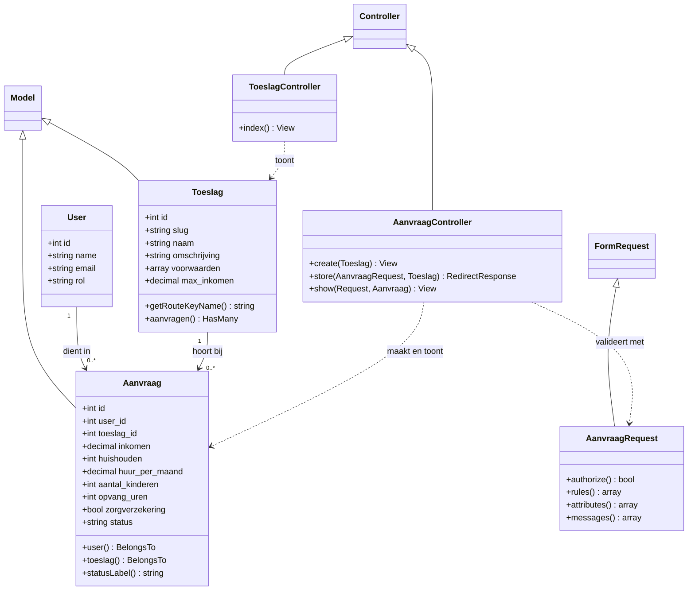

# Class diagram – toeslagen en aanvragen (Ahmet)

Dit class diagram laat de classes zien van mijn onderdelen: overzicht beschikbare toeslagen, huurtoeslag, zorgtoeslag en kinderopvangtoeslag aanvragen, en status per aanvraag. `User` is van Ilyas en staat erbij omdat een aanvraag bij een gebruiker hoort.

## Uitleg

| Class | Wat doet het |
|---|---|
| `Toeslag` | Een toeslag (huur-, zorg- of kinderopvangtoeslag). De `slug` wordt in de URL gebruikt, bijvoorbeeld `/toeslagen/huurtoeslag/aanvragen`. |
| `Aanvraag` | Een aanvraag van een burger. Velden die maar bij één toeslag horen (huur, kinderen, opvanguren, zorgverzekering) zijn nullable. `statusLabel()` geeft de status als leesbare tekst. |
| `ToeslagController` | `index()` toont het overzicht van beschikbare toeslagen. |
| `AanvraagController` | `create()` toont het formulier, `store()` slaat de aanvraag op met status *in behandeling*, `show()` toont de status van één aanvraag (403 als de aanvraag van iemand anders is). |
| `AanvraagRequest` | Validatie. `rules()` geeft per toeslag andere regels via `match`. |
